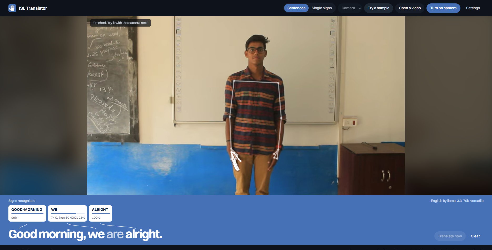
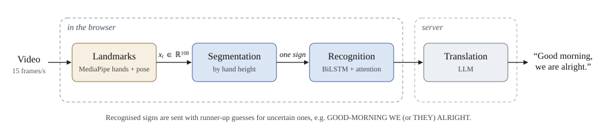
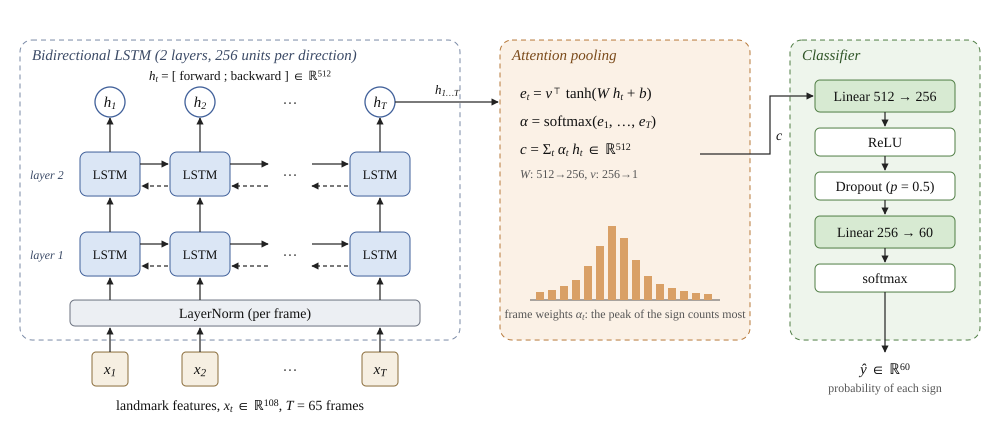

# Indian Sign Language Translator

Recognises Indian Sign Language (ISL) from a webcam and turns a sequence of signs
into an English sentence. A BiLSTM with attention recognises each sign from hand and
body landmarks; an LLM then writes the signs as a grammatical sentence, adding the
words ISL leaves out. Everything except the LLM call runs in the browser.

<p align="center">
  
  <br><em>The built-in sample: three held-out test clips read as one sentence. Lighter words were
  added by the LLM. (The LLM reply here was supplied by a test, as no API key was set.)</em>
</p>

## How it works

<p align="center"></p>
<p align="center"><em>Figure 1. The pipeline.</em></p>

1. **Landmarks.** MediaPipe tracks 12 arm points and 21 points per hand. Each frame becomes 108 numbers.
2. **Finding each sign.** A sign starts when a hand rises to the chest and ends when it drops or holds still for 0.8 s, measured against shoulder width so camera distance doesn't matter.
3. **Recognition.** Each sign is resampled to 65 frames and classified into one of 60 signs.
4. **Translation.** The signs, plus runner-up guesses for uncertain ones, go to an LLM, which can use the sentence's context to fix a likely mistake (WE or THEY).

<p align="center"></p>
<p align="center"><em>Figure 2. The recognition model (2.6 M parameters).</em></p>

## Results

Trained on 60 signs from the [INCLUDE](https://zenodo.org/records/4010759) dataset, chosen so they combine into
sentences (pronouns, greetings, family, jobs, places, time words, adjectives). Evaluated once on
INCLUDE's held-out test split.

| Task | Test set | Result |
|---|---|---|
| Single signs | 209 videos | **98.6%** accuracy, macro F1 0.987 |
| Sentences, with a rest between signs | 200 sentences of 2-4 signs | **4.6%** word error rate, 89.5% exactly right |
| Sentences, signs back to back | 200 sentences of 2-4 signs | **3.6%** word error rate, 91.0% exactly right |

The sentences are built by joining test clips ([`scripts/eval_continuous.py`](scripts/eval_continuous.py)).
For comparison, segmenting by motion instead of hand position gives 34-49% word error rate
on the same sentences. The three single-sign errors are I read as YOU (twice) and BROTHER
read as SISTER: pointing toward or away from the camera is hard to tell apart without depth.

Details: [`models/isl60/`](models/isl60/) (per-sign report, [confusion matrix](models/isl60/confusion_test.png),
[training curves](models/isl60/training_curves.png), [sentence results](models/isl60/continuous_test.json)).

## Run it

```bash
python -m venv .venv
.venv\Scripts\activate            # macOS/Linux: source .venv/bin/activate
pip install -r requirements.txt --extra-index-url https://download.pytorch.org/whl/cpu
cp .env.example .env              # add an LLM_API_KEY (free at console.groq.com)
python -m server                  # http://localhost:8000
```

Press **Try a sample**, or turn on the camera: raise a hand to sign, lower it or hold still
between signs, and pause to translate. Without an API key the signs are shown as written.
Any OpenAI-compatible endpoint works, including a local model through Ollama
(`LLM_BASE_URL=http://localhost:11434/v1`).

## Train it

```bash
python scripts/run_all.py --config configs/isl60.yaml --data-dir data --out runs --workers 8
```

This downloads only the needed INCLUDE videos, extracts landmarks with augmentation
(noise, rotation, cutout), trains (about 10 minutes on a CPU), evaluates and exports the
model for the browser. Landmark extraction is the slow step, about 2 hours on a laptop.
[`configs/`](configs/) also has INCLUDE-50, the standard 50-sign benchmark. Tests: `pytest`.

## Limitations

- 60 signs, from a dataset with few signers. Expect lower accuracy for new signers, lighting and backgrounds.
- Signs need a boundary (lower the hands or hold still). Fluent, blended signing would need continuous training data.
- Hands and arms only: no facial expressions, which carry grammar in ISL.

## Credits

[@reubenjrouse](https://github.com/reubenjrouse) and [@leharrathore25](https://github.com/leharrathore25),
supervised by Dr. Vaishali Kulkarni (NMIMS, Mumbai).
Data: INCLUDE, Sridhar et al., ACM Multimedia 2020, CC BY 4.0. MIT License.
